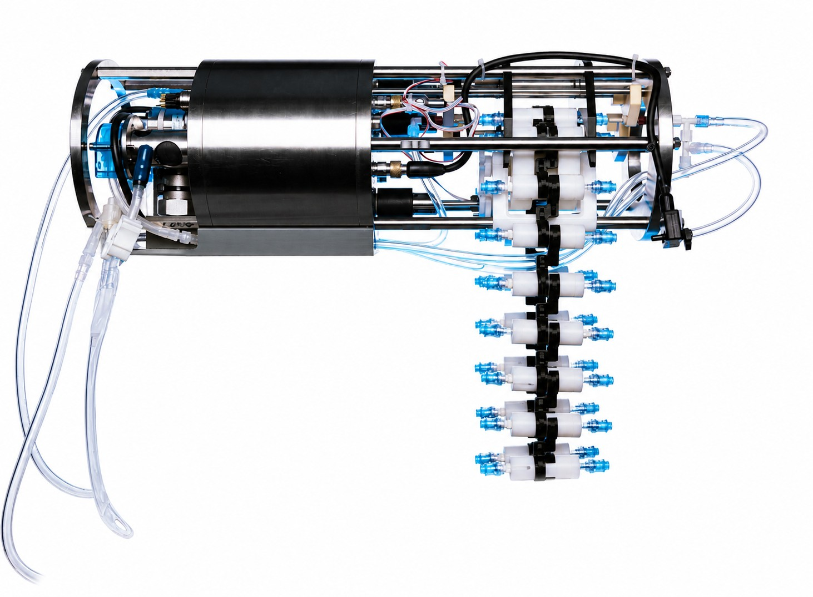

# 🧭 Introduction

This project evaluates the use of Oxford Nanopore Technologies (ONT) sequencing combined with a Tree of Life metabarcoding approach for broad-scale marine biodiversity assessment. Environmental DNA (eDNA) samples were collected using the **RoCSI autonomous sampling system** and subsequently analysed using the **portable MinION sequencing platform**, providing a workflow that combines autonomous marine sampling with rapid, portable molecular analysis.

<div style="display:flex; justify-content:center; gap:3rem; align-items:flex-start; margin:1.5rem auto;">

<div style="width:35%; text-align:center;">  <p style="font-size:0.9em; margin-top:0.4rem;">The NOC’s Robotic Cartridge Sampling Instrument (RoCSI).</p> </div>

<div style="width:35%; text-align:center;">  <p style="font-size:0.9em; margin-top:0.4rem;">The Oxford Nanopore MinION sequencing device.</p> </div>

</div>

The study uses 33 seawater samples collected during the **BIO-Carbon II** cruise aboard the *RRS James Cook*, along a transect extending from northern Scotland to Cardiff and covering much of the west coast of Great Britain. The transect spans contrasting marine environments and substantial gradients in environmental conditions, including temperature, salinity and chlorophyll concentration, providing a valuable test bed for assessing the ability of ONT metabarcoding to characterise biodiversity across different marine habitats.

{fig-cap="Map of UK showing the chlorophyll concentrations and the location of the samples" width="100%"
fig-align="center"
}

By integrating portable nanopore sequencing with autonomous eDNA sampling, the project also contributes to the development of faster and more scalable approaches to marine biodiversity monitoring. Ultimately, such workflows could support the transition from conventional retrospective eDNA analysis towards near-real-time biodiversity observations at sea.

## Metadata plots

Before looking into the metabarcoding data, let's have a quick look at the metadata.

```{r, message=FALSE, warning=FALSE}
library(dplyr)
library(readxl)
library(tidyverse)
library(stringr)
library(tibble)
library(Biostrings)
library(ggOceanMaps)
library(ggspatial)

# # Metadata → rownames = barcodeXX
# meta <- read_xlsx("data/Metadata_JC269_UKWC.xlsx")
# 
# meta <- meta %>%
#   mutate(
#     Lon = as.numeric(Lon),
#     Lat = as.numeric(Lat)
#   )

```


# 🧬 Sequencing and bioinformatics overview


Six metabarcoding markers were used to characterise complementary components of marine eDNA biodiversity. For each marker, **33 environmental samples and two negative controls** (extraction and PCR controls) were analysed, representing **210 sequencing libraries**.

- **16S rRNA V4:** Bacteria and archaea
- **18S rRNA V4:** Eukaryotes, including protists and phytoplankton
- **COI:** Metazoans
- **12S rRNA (MiFish):** Fish
- **ITS:** Primarily fungi
- **rbcL:** Photosynthetic organisms, particularly diatoms

Amplicons were sequenced at the **Centre for Genomic Research (CGR), University of Liverpool**, using Illumina MiSeq i100 paired-end sequencing (2 × 300 bp).

## Metabarcoding markers and primers

```{r}
library(knitr)
library(kableExtra)

primers <- tibble::tribble(
  ~Marker, ~`Fragment (bp)`, ~Primer, ~`Sequence (5′–3′)`, ~Reference,
  "16S V4", "~252", "515F_mod_CGR", "GTGYCAGCMGCCGCGGTAA", "Parada et al.",
  "16S V4", "~252", "806R_mod_CGR", "GGACTACNVGGGTWTCTAAT", "Apprill et al.",
  "18S V4", "~400", "TAReuk454FWD1_CGR", "CCAGCASCYGCGGTAATTCC", "Stoeck et al., 2010",
  "18S V4", "~400", "TAReukREV3_CGR", "ACTTTCGTTCTTGATYRA", "Stoeck et al., 2010",
  "COI", "~313", "mlCOIintF_CGR", "GGWACWGGWTGAACWGTWTAYCCYCC", "Leray, 2013",
  "COI", "~313", "jgHCO2198_CGR", "TAIACYTCIGGRTGICCRAARAAYCA", "Folmer et al., 1994",
  "MiFish (12S)", "~170", "MiFish-U-F_CGR", "GTCGGTAAAACTCGTGCCAGC", "Miya et al., 2015",
  "MiFish (12S)", "~170", "MiFish-U-R_mod_CGR", "CATAGTGGGGTATCTAATCCCAGTTTGT", "Stoeckle et al., 2022",
  "ITS2", "~250", "ITS3", "GCATCGATGAAGAACGCAGC", "White et al., 1990",
  "ITS2", "~250", "ITS4", "TCCTCCGCTTATTGATATGC", "White et al., 1990",
  "rbcL", "~312", "708F-DEG", "AGGTGAAGYWAAAGGTTCWTAYTTAAA", "Vasselon et al., 2017",
  "rbcL", "~312", "R3-DEG", "CCTTCTAATTTACCWACWACWG", "Vasselon et al., 2017"
)

primers |>
  kbl(
    format = "html",
    escape = TRUE,
    align = c("l", "c", "l", "l", "l")
  ) |>
  kable_styling(
    bootstrap_options = c("striped", "condensed"),
    full_width = FALSE,
    position = "center"
  ) |>
  column_spec(1, width = "115px", bold = TRUE) |>
  column_spec(2, width = "95px") |>
  column_spec(3, width = "195px") |>
  column_spec(4, width = "285px", extra_css = "font-family: monospace; font-size: 0.9em;") |>
  column_spec(5, width = "150px") |>
  collapse_rows(
    columns = 1:2,
    valign = "middle",
    row_group_label_position = "stack"
  )
```

**Library preparation:** CGR overhang sequences were added to the 5′ ends of the forward (`ACACTCTTTCCCTACACGACGCTCTTCCGATCT`) and reverse (`GTGACTGGAGTTCAGACGTGTGCTCTTCCGATCT`) primers. These overhangs are excluded from the sequences in the table.

## Bioinformatics processing parameters

Primer trimming was performed with **Cutadapt v5.2**, followed by ASV inference and taxonomic assignment using **DADA2**.

For all markers, Cutadapt used an **error rate of 0.1**, minimum primer **overlap of 15 bp**, **no indels** and `--discard-untrimmed`. Both forward and reverse primer matches were required.

```{r}

params <- tribble(
  ~Marker, ~`Truncation R1/R2 (bp)`, ~`Taxonomic reference`,
  "16S",    "250 / 250", "SILVA 138.2",
  "18S",    "270 / 255", "PR2 5.1.0",
  "COI",    "260 / 260", "MIDORI2 GB273",
  "MiFish", "None",      "MitoFish (Jul 2026)",
  "ITS",    "270 / 270", "UNITE (Feb 2025)",
  "rbcL",   "250 / 250", "Diat.barcode 16.3"
)

params |>
  kbl(
    format = "html",
    align = c("l", "c", "l"),
    escape = TRUE
  ) |>
  kable_styling(
    bootstrap_options = c("striped", "condensed"),
    full_width = FALSE,
    position = "center"
  ) |>
  column_spec(1, bold = TRUE, width = "90px") |>
  column_spec(2, width = "190px") |>
  column_spec(3, width = "190px")
```


**DADA2 settings shared across markers:**

- **Filtering:** `maxEE = c(2,3)`, `maxN = 0`, `minLen = 200`, `rm.phix = TRUE`.
- **Denoising:** Independent forward/reverse error models, with `pool = "pseudo"`.
- **Paired-end merging:** `minOverlap = 90`, `trimOverhang = TRUE`.
- **Chimera removal:** `method = "consensus"`, `allowOneOff = FALSE`.
- **Taxonomy:** `assignTaxonomy()` using marker-specific reference databases; 16S species-level assignment additionally used `addSpecies()`.

Truncation lengths are expressed as R1/R2 in base pairs. "None" indicates no fixed-length truncation. Other unspecified settings used DADA2 defaults.


```{r load_data}
data_dir <- "data/Illumina"
markers <- c("16S", "18S", "COI", "MiFish", "ITS", "rbcL")

for (m in markers) {
  track <- readRDS(file.path(data_dir, paste0(m, "_read-count-tracking.rds")))
  seqtab <- readRDS(file.path(data_dir, paste0(m, "_seqtab_nochim.rds")))
  taxa   <- readRDS(file.path(data_dir, paste0(m, "_taxa.rds")))

  assign(paste0("track_", m), track)
  assign(paste0("seqtab_", m), seqtab)
  assign(paste0("taxa_", m), taxa)
}
```

```{r reads_track_table}
qc_samples <- map_dfr(markers, function(m) {

  track <- get(paste0("track_", m))
  seqtab <- get(paste0("seqtab_", m))

  # Check sample matching
  stopifnot(setequal(rownames(track), rownames(seqtab)))

  # Match tracking rows to ASV table rows
  track <- track[rownames(seqtab), , drop = FALSE]

  tibble(
    marker = m,
    sample = rownames(seqtab),
    input_reads = track[, "dada2_input"],
    filtered_reads = track[, "filtered"],
    merged_reads = track[, "merged"],
    final_reads = track[, "nonchim"],
    retention = track[, "final_perc_reads_retained"],
    n_ASVs = rowSums(seqtab > 0),
    sample_type = case_when(
      str_detect(sample, "Extract-ctrl$") ~ "Extraction control",
      str_detect(sample, "NTC$") ~ "PCR control",
      TRUE ~ "Biological"
    )
  )
})
```


```{r}
#| label: fig-illumina-qc
#| fig-width: 12
#| fig-height: 7
#| warning: false
#| message: false

# 1. Combine DADA2 tracking data -----------------------------------------

qc_tracking <- purrr::map_dfr(markers, function(m) {

  get(paste0("track_", m)) %>%
    as.data.frame() %>%
    tibble::rownames_to_column("sample") %>%
    mutate(
      marker = m,
      sample_type = case_when(
        str_detect(sample, "Extract-ctrl$") ~ "Extraction control",
        str_detect(sample, "NTC$") ~ "PCR control",
        TRUE ~ "Biological"
      )
    )
})

# 2. Calculate median reads at each processing step -----------------------

qc_steps <- qc_tracking %>%
  filter(sample_type == "Biological") %>%
  group_by(marker) %>%
  summarise(
    across(
      c(dada2_input, filtered, dada_f, merged, nonchim),
      median
    ),
    .groups = "drop"
  ) %>%
  pivot_longer(
    cols = -marker,
    names_to = "step",
    values_to = "median_reads"
  ) %>%
  mutate(
    step = factor(
      step,
      levels = c("dada2_input", "filtered", "dada_f",
                 "merged", "nonchim")
    )
  )

# 3. Figure: DADA2 read retention ----------------------------------------

p_retention <- ggplot(
  qc_steps,
  aes(x = step, y = median_reads, group = 1)
) +
  geom_line(colour = "#0072B2", linewidth = 0.8) +
  geom_point(colour = "#0072B2", size = 2.5) +
  facet_wrap(~ marker, scales = "free_y") +
  scale_x_discrete(labels = c(
    dada2_input = "Input",
    filtered = "Filtered",
    dada_f = "Denoised F",
    merged = "Merged",
    nonchim = "Nonchim"
  )) +
  scale_y_continuous(labels = scales::label_comma()) +
  labs(
    x = NULL,
    y = "Median reads per sample",
    title = "DADA2 read retention across markers",
    subtitle = "Biological samples only"
  ) +
  theme_bw(base_size = 11) +
  theme(
    panel.grid.minor = element_blank(),
    axis.text.x = element_text(angle = 40, hjust = 1)
  )

print(p_retention)

# 4. Figure: Final sequencing depth per sample ----------------------------

p_depth <- qc_samples %>%
  mutate(
    marker = factor(marker, levels = markers),
    sample_type = factor(
      sample_type,
      levels = c("Biological", "Extraction control", "PCR control")
    ),
    sample_order = as.integer(str_extract(sample, "^[0-9]+"))
  ) %>%
  ggplot(aes(
    x = sample_order,
    y = final_reads,
    fill = sample_type
  )) +
  geom_col(width = 0.85) +
  facet_wrap(~ marker, scales = "free_y") +
  scale_fill_manual(values = c(
    "Biological" = "#0072B2",
    "Extraction control" = "#D55E00",
    "PCR control" = "#CC79A7"
  )) +
  scale_x_continuous(breaks = c(1, 10, 20, 30, 34, 35)) +
  scale_y_continuous(labels = scales::label_comma()) +
  labs(
    x = "Sample number",
    y = "Non-chimeric reads",
    fill = NULL,
    title = "Final sequencing depth per sample"
  ) +
  theme_bw(base_size = 11) +
  theme(
    panel.grid.minor = element_blank(),
    legend.position = "bottom"
  )

print(p_depth)
```


```{r}
#| label: fig-dada2-combined
#| fig-width: 9
#| fig-height: 5
#| fig-cap: "Median DADA2 read retention across markers, expressed relative to the median input read count."

# Calculate percentage retention per marker
qc_steps_perc <- qc_steps %>%
  group_by(marker) %>%
  mutate(
    retention = 100 * median_reads /
      median_reads[step == "dada2_input"]
  ) %>%
  ungroup()

# Combined plot

p_retention_combined <- ggplot(
  qc_steps_perc,
  aes(x = step, y = retention, colour = marker, group = marker)
) +
  geom_line(linewidth = 1) +
  geom_point(size = 2.5) +
  scale_x_discrete(labels = c(
    dada2_input = "Input",
    filtered = "Filtered",
    dada_f = "Denoised F",
    merged = "Merged",
    nonchim = "Nonchim"
  )) +
  scale_y_continuous(
    breaks = seq(80, 100, 5),
    labels = scales::label_percent(scale = 1)
  ) +
  coord_cartesian(ylim = c(80, 100)) +
  scale_colour_brewer(palette = "Dark2") +
  labs(
    x = NULL,
    y = "Reads retained (%)",
    colour = "Marker",
    title = "DADA2 read retention across markers"
  ) +
  theme_bw(base_size = 12) +
  theme(
    panel.grid.minor = element_blank(),
    legend.position = "right"
  )

p_retention_combined

```


## Quality control by marker {.tabset}

::: {.panel-tabset}

### 16S

```{r}
#| echo: false
#| fig-width: 9
#| fig-height: 4

p_retention %+% subset(qc_steps, marker == "16S") +
  facet_null()
```

### 18S

```{r}
#| echo: false
#| fig-width: 9
#| fig-height: 4

p_retention %+% subset(qc_steps, marker == "18S") +
  facet_null()
```

### COI

```{r}
#| echo: false
#| fig-width: 9
#| fig-height: 4

p_retention %+% subset(qc_steps, marker == "COI") +
  facet_null()
```

### MiFish

```{r}
#| echo: false
#| fig-width: 9
#| fig-height: 4

p_retention %+% subset(qc_steps, marker == "MiFish") +
  facet_null()
```

### ITS

```{r}
#| echo: false
#| fig-width: 9
#| fig-height: 4

p_retention %+% subset(qc_steps, marker == "ITS") +
  facet_null()
```

### rbcL

```{r}
#| echo: false
#| fig-width: 9
#| fig-height: 4

p_retention %+% subset(qc_steps, marker == "rbcL") +
  facet_null()
```

:::


```{r}
#| label: fig-rarefaction-combined
#| fig-width: 9
#| fig-height: 5
#| warning: false
#| message: false

library(tidyverse)
library(vegan)

markers <- c("16S", "18S", "COI", "MiFish", "ITS", "rbcL")

# Calculate rarefaction curves -------------------------------------------

rarefaction <- purrr::map_dfr(markers, function(m) {

  seqtab <- get(paste0("seqtab_", m))

  # Exclude both negative controls
  seqtab <- seqtab[
    !grepl("Extract-ctrl$|NTC$", rownames(seqtab)),
    , drop = FALSE
  ]

  # Remove zero-depth samples
  seqtab <- seqtab[rowSums(seqtab) > 0, , drop = FALSE]

  # Depths covering the full range of each sample
  max_depth <- max(rowSums(seqtab))
  depths <- unique(round(seq(1, max_depth, length.out = 60)))

  purrr::map_dfr(seq_len(nrow(seqtab)), function(i) {

    sample_depth <- rowSums(seqtab[i, , drop = FALSE])

    d <- unique(c(
      depths[depths <= sample_depth],
      sample_depth
    ))

    tibble(
      marker = m,
      sample = rownames(seqtab)[i],
      depth = d,
      richness = vapply(
        d,
        function(n) as.numeric(
          vegan::rarefy(seqtab[i, , drop = FALSE], sample = n)
        ),
        numeric(1)
      )
    )
  })
})

# Summary curves:
# Recalculate on a common depth grid for each marker so that
# all biological samples contribute at every plotted depth.

rarefaction_summary <- purrr::map_dfr(markers, function(m) {

  x <- get(paste0("seqtab_", m))

  # Exclude negative controls
  x <- x[!grepl("Extract-ctrl$|NTC$", rownames(x)), , drop = FALSE]

  # Exclude COI sample 22
  if (m == "COI") {
    x <- x[!grepl("^22_COI_", rownames(x)), , drop = FALSE]
  }

  depths <- unique(round(seq(1, min(rowSums(x)), length.out = 60)))

  purrr::map_dfr(depths, function(d) {

    richness <- as.numeric(vegan::rarefy(x, sample = d))

    tibble(
      marker = m,
      depth = d,
      mean_richness = mean(richness),
      sd_richness = sd(richness)
    )
  })
})

# Combined figure --------------------------------------------------------

p_rarefaction_combined <- ggplot(
  rarefaction_summary,
  aes(x = depth, y = mean_richness, colour = marker, fill = marker)
) +
  geom_ribbon(
    aes(
      ymin = pmax(0, mean_richness - sd_richness),
      ymax = mean_richness + sd_richness
    ),
    alpha = 0.15,
    colour = NA
  ) +
  geom_line(linewidth = 1.1) +
  scale_colour_brewer(palette = "Dark2") +
  scale_fill_brewer(palette = "Dark2") +
  scale_x_continuous(labels = scales::label_comma()) +
  labs(
    x = "Sequencing depth (reads)",
    y = "Expected ASV richness",
    colour = "Marker",
    fill = "Marker",
    title = "Rarefaction curves across markers",
    subtitle = "Mean ± SD across biological samples"
  ) +
  theme_bw(base_size = 12) +
  theme(
    panel.grid.minor = element_blank(),
    legend.position = "right"
  )

p_rarefaction_combined
```

```{r rarefaction}
plot_rarefaction <- function(m) {

  rarefaction %>%
    filter(marker == m) %>%
    ggplot(aes(
      x = depth,
      y = richness,
      group = sample
    )) +
    geom_line(
      colour = "#0072B2",
      alpha = 0.45,
      linewidth = 0.6
    ) +
    scale_x_continuous(labels = scales::label_comma()) +
    labs(
      x = "Sequencing depth (reads)",
      y = "Expected ASV richness",
      title = paste0(m, " rarefaction curves"),
      subtitle = "Individual biological samples"
    ) +
    theme_bw(base_size = 12) +
    theme(
      panel.grid.minor = element_blank()
    )
}
```


::: {.panel-tabset}

## 16S

```{r}
#| echo: false
#| fig-width: 9
#| fig-height: 5
plot_rarefaction("16S")
```

## 18S

```{r}
#| echo: false
#| fig-width: 9
#| fig-height: 5
plot_rarefaction("18S")
```

## COI

```{r}
#| echo: false
#| fig-width: 9
#| fig-height: 5
plot_rarefaction("COI")
```

## MiFish

```{r}
#| echo: false
#| fig-width: 9
#| fig-height: 5
plot_rarefaction("MiFish")
```


## ITS

```{r}
#| echo: false
#| fig-width: 9
#| fig-height: 5
plot_rarefaction("ITS")
```

## rbcL

```{r}
#| echo: false
#| fig-width: 9
#| fig-height: 5
plot_rarefaction("rbcL")
```

:::

# 📦 Building the phyloseq objects

```{r making_ps_objects}
library(phyloseq)

markers <- c("16S", "18S", "COI", "MiFish", "ITS", "rbcL")

for (m in markers) {

  seqtab <- get(paste0("seqtab_", m))
  taxa <- get(paste0("taxa_", m))

  # Check that taxonomy and ASV sequences match
  stopifnot(setequal(colnames(seqtab), rownames(taxa)))

  # Align taxonomy to the ASV table
  taxa <- taxa[colnames(seqtab), , drop = FALSE]

  # Assign simple ASV identifiers
  asv_ids <- paste0("ASV", seq_len(ncol(seqtab)))

  sequences <- colnames(seqtab)

  colnames(seqtab) <- asv_ids
  rownames(taxa) <- asv_ids

  # Sample metadata
  metadata <- data.frame(
    SampleID = rownames(seqtab),
    SampleType = ifelse(
      grepl("Extract-ctrl$", rownames(seqtab)), "Extraction control",
      ifelse(
        grepl("NTC$", rownames(seqtab)), "PCR control", "Biological"
      )
    ),
    row.names = rownames(seqtab)
  )

  # Create phyloseq object
  ps <- phyloseq(
    otu_table(seqtab, taxa_are_rows = FALSE),
    tax_table(as.matrix(taxa)),
    sample_data(metadata),
    refseq(Biostrings::DNAStringSet(
      setNames(sequences, asv_ids)
    ))
  )

  assign(paste0("ps_", m), ps)
}

# 18S - PR2
colnames(tax_table(ps_18S)) <- c(
  "Domain", "Supergroup", "Division", "Subdivision",
  "Class", "Order", "Family", "Genus", "Species"
)

# rbcL - Diat.barcode 16.3
colnames(tax_table(ps_rbcL)) <- c(
  "Empire", "Kingdom", "Subkingdom", "Phylum",
  "Subphylum", "Class", "Order", "Family",
  "Genus", "Species"
)
```

## Proportion of unassigned ASVs

```{r unclassified_ASVs}
unclassified_summary <- purrr::map_dfr(markers, function(m) {

  ps <- get(paste0("ps_", m))

  tax_df <- as.data.frame(as(tax_table(ps), "matrix"))

  tax_df %>%
    summarise(across(
      everything(),
      ~ sum(
        is.na(.) |
        trimws(as.character(.)) == "" |
        tolower(trimws(as.character(.))) == "unclassified"
      )
    )) %>%
    pivot_longer(
      everything(),
      names_to = "Rank",
      values_to = "n_unclassified_ASVs"
    ) %>%
    mutate(
      Marker = m,
      total_ASVs = ntaxa(ps),
      percent_unclassified = 100 * n_unclassified_ASVs / total_ASVs
    )
})

unclassified_summary
```

```{r plot_unassigned_ASVs}
# Preserve taxonomic rank order as stored in the taxonomy tables
rank_order <- unique(unclassified_summary$Rank)

unclassified_summary <- unclassified_summary %>%
  mutate(
    Marker = factor(Marker, levels = markers),
    Rank = factor(Rank, levels = rank_order)
  )

p_unclassified <- ggplot(
  unclassified_summary,
  aes(x = Rank, y = percent_unclassified)
) +
  geom_col(fill = "#0072B2", width = 0.75) +
  facet_wrap(~ Marker, scales = "free_x") +
  scale_y_continuous(
    limits = c(0, 100),
    breaks = seq(0, 100, 20),
    labels = function(x) paste0(x, "%")
  ) +
  labs(
    x = "Taxonomic rank",
    y = "Unclassified ASVs (%)",
    title = "Proportion of unclassified ASVs across markers"
  ) +
  theme_classic(base_size = 12) +
  theme(
    axis.text.x = element_text(angle = 60, hjust = 1),
    strip.background = element_rect(fill = "grey95", colour = NA),
    strip.text = element_text(face = "bold")
  )

p_unclassified
```

```{r, fig.width= 12, fig.height=7}
# Preserve taxonomic rank order as stored in the taxonomy tables
rank_order <- unique(unclassified_summary$Rank)

unclassified_summary <- unclassified_summary %>%
  mutate(
    Marker = factor(Marker, levels = markers),
    Rank = factor(Rank, levels = rank_order)
  )

p_unclassified <- ggplot(
  unclassified_summary,
  aes(x = Rank, y = percent_unclassified)
) +
  geom_col(fill = "#0072B2", width = 0.75) +
  facet_wrap(~ Marker, scales = "free_x") +
  scale_y_continuous(
    limits = c(0, 100),
    breaks = seq(0, 100, 20),
    labels = function(x) paste0(x, "%")
  ) +
  labs(
    x = "Taxonomic rank",
    y = "Unclassified ASVs (%)",
    title = "Proportion of unclassified ASVs across markers"
  ) +
  theme_classic(base_size = 12) +
  theme(
    axis.text.x = element_text(angle = 60, hjust = 1),
    strip.background = element_rect(fill = "grey95", colour = NA),
    strip.text = element_text(face = "bold")
  )

p_unclassified
```

```{r}
#| label: fig-assigned-asvs-combined
#| fig-width: 10
#| fig-height: 5
#| warning: false
#| message: false

library(tidyverse)
library(phyloseq)

markers <- c("16S", "18S", "COI", "MiFish", "ITS", "rbcL")

# Define a general taxonomic order spanning all databases
rank_levels <- c(
  "Empire",
  "Domain",
  "Kingdom",
  "Supergroup",
  "Division",
  "Subdivision",
  "Subkingdom",
  "Phylum",
  "Subphylum",
  "Class",
  "Order",
  "Family",
  "Genus",
  "Species"
)

# Count assigned ASVs at each rank for each marker
assigned_summary <- purrr::map_dfr(markers, function(m) {
  
  ps <- get(paste0("ps_", m))
  tax_df <- as.data.frame(as(tax_table(ps), "matrix"))
  
  tibble(
    Rank = colnames(tax_df),
    n_assigned_ASVs = sapply(tax_df, function(x) {
      sum(
        !is.na(x) &
        trimws(as.character(x)) != "" &
        !tolower(trimws(as.character(x))) %in% c("na", "unclassified")
      )
    }),
    Marker = m,
    total_ASVs = ntaxa(ps)
  )
})

# Keep only ranks that are actually present
assigned_summary <- assigned_summary %>%
  mutate(
    Rank = factor(Rank, levels = rank_levels),
    Marker = factor(Marker, levels = markers)
  ) %>%
  arrange(Marker, Rank)

# Combined plot
p_assigned_combined <- ggplot(
  assigned_summary,
  aes(x = Rank, y = n_assigned_ASVs, colour = Marker, group = Marker)
) +
  geom_line(linewidth = 1) +
  geom_point(size = 2.5) +
  scale_colour_brewer(palette = "Dark2") +
  scale_y_continuous(labels = scales::label_comma()) +
  labs(
    x = "Taxonomic rank",
    y = "Assigned ASVs (n)",
    colour = "Marker",
    title = "Number of assigned ASVs across taxonomic ranks"
  ) +
  theme_bw(base_size = 12) +
  theme(
    panel.grid.minor = element_blank(),
    axis.text.x = element_text(angle = 45, hjust = 1),
    legend.position = "right"
  )

p_assigned_combined
```